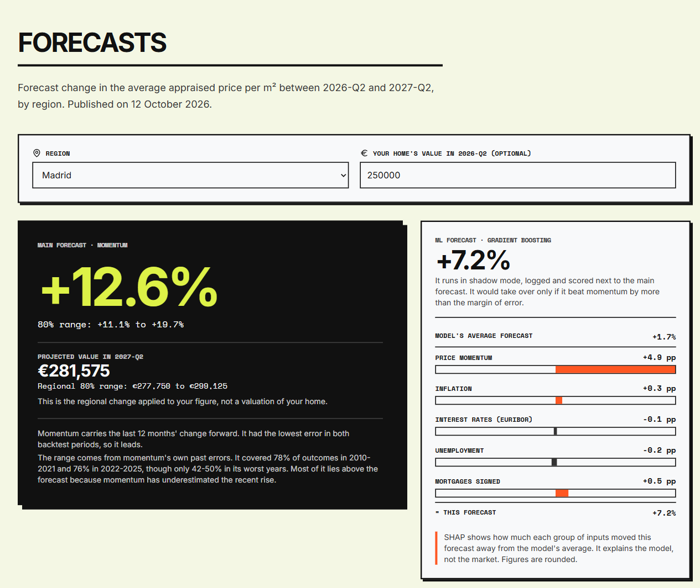
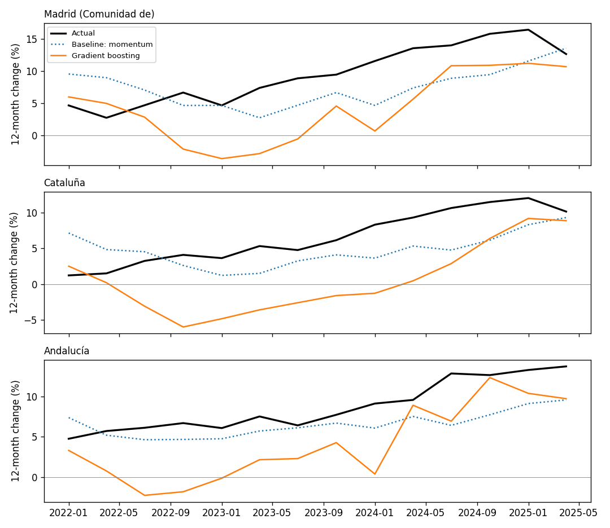

# Casalia

**Spanish house price forecasts you can check.** Casalia forecasts the 12-month change in the appraised price per m² for every Spanish region. It uses official data and is backtested walk-forward on every year from 2010.

Ridge regression, gradient boosting and a PyTorch MLP compete with simple rules over the same years, including a 2022-2025 holdout frozen before scoring. So far a momentum rule has done best, so the site serves it with an 80% range, and gradient boosting runs in shadow mode with SHAP explanations. From 2026-Q2 on, each quarter's forecasts are committed here before the outcome is known.

It's a ground-up rebuild of my vocational-degree final project ([history](#history)).

[Live site](https://antonio-rosendo.github.io/Casalia/) · [Findings](FINDINGS.md) · [Forecast log](ml/forecasts/) · [Reports](ml/reports/)

[](https://github.com/antonio-rosendo/Casalia/actions/workflows/ci.yml)



## Results

Each model was retrained every year and scored on the following year (walk-forward, 2010-2021). The last four years, 2022-2025, were held out, and the protocol was committed before they were scored. The table shows the mean absolute error of the 12-month change, in percentage points (lower is better), over 17 regions.

| Model | Development 2010-2021 | Frozen holdout 2022-2025 |
|---|---:|---:|
| Momentum (last 12 months carried forward) | **3.35** | **3.40** |
| No change | 3.63 | 7.51 |
| Historical mean | 4.44 | 6.74 |
| Ridge regression | 4.72 | 6.05 |
| Gradient boosting | 3.66 | 6.24 |
| Neural network (PyTorch MLP) | 5.56 | 7.72 |

- **Development:** gradient boosting was the best trained model, 0.31 pp behind momentum. The 95% block-bootstrap interval of the gap (−0.29 to +0.91 pp) includes zero.
- **Holdout:** momentum was best in all four years. A pre-registered diagnostic traced gradient boosting's 2022 miss to inflation, and its 2023 miss to how fast the Euribor rose. Both were beyond anything in the training data.
- **What is served:** momentum is the main forecast, with an empirical 80% range (78% coverage in development). Gradient boosting runs in shadow mode with grouped SHAP explanations. It takes over only if it beats momentum with a 95% interval of the gap that excludes zero, and then also on the forecast log.



[FINDINGS.md](FINDINGS.md) has the full story, including what was wrong with the first version.

## How it works

- **Data.** [`build_dataset.py`](ml/build_dataset.py) downloads:
  - the appraised price per m² (MIVAU);
  - CPI, mortgages and unemployment (INE API);
  - the 12-month Euribor (ECB API).

  It builds one quarterly table for 17 regions plus Ceuta and Melilla.
- **No look-ahead.**
  - Features only use data up to the quarter a forecast starts from.
  - A training row is used only once its outcome has been published (the purge).
  - Forecasts are only made from quarters that every source has published.
  - Tests check that changing future data never changes past features or the range, and that serving and training build identical rows.
- **Evaluation.** Walk-forward by year, with hyperparameters tuned inside each training window. The models are compared against three naive baselines, with block-bootstrap intervals and a holdout frozen before scoring.
- **Serving.** Once a quarter, [`publish_forecasts.py`](ml/publish_forecasts.py) trains the models and writes the forecasts, ranges and SHAP values to JSON. One copy goes to the forecast log and is never edited. The other feeds the static site, and a FastAPI service (with a Docker image) that serves it over HTTP.

## What's in the repo

```
ml/
  build_dataset.py      official sources -> data/processed/dataset.csv
  features.py           features shared by evaluation, forecasts and tests
  models.py             baselines, Ridge, gradient boosting, MLP
  model.py              the MLP network, kept from the first version
  evaluate.py           walk-forward and frozen holdout -> reports/
  intervals.py          empirical 80% range for momentum
  diagnostics.py        pre-registered SHAP and ablation analysis
  forecast.py           main and ML forecasts, with SHAP
  publish_forecasts.py  writes the forecast log and the site's data
  score_forecasts.py    scores logged forecasts once the outcome is published
  app/                  FastAPI service
  tests/                leakage, parity, evaluation and API tests
  forecasts/            the forecast log
  reports/              results, holdout, intervals, diagnostics
web/                    static site: React, TypeScript, Tailwind, English and Spanish
.github/workflows/      CI, site deployment, quarterly forecasts
```

## Run it

```bash
cd ml
python -m venv .venv
source .venv/bin/activate      # Windows: .venv\Scripts\activate
pip install torch==2.11.0 --index-url https://download.pytorch.org/whl/cpu   # CPU-only build
pip install -r requirements-dev.txt

python evaluate.py               # development results -> reports/results.md
python forecast.py               # current forecasts
pytest -q                        # leakage, parity, evaluation and API tests
python build_dataset.py --refresh   # rebuild the dataset from the sources
```

The processed dataset is committed, so every command above except `build_dataset.py` works offline.

To run the API in Docker, from the repository root:

```bash
docker build -t casalia-api .
docker run -p 8000:8000 casalia-api      # docs at http://localhost:8000/docs
```

To run the site, also from the repository root: `cd web && npm install && npm run dev`.

## Limits

- Appraised prices move more smoothly than sale prices, which is part of why momentum does well.
- The data are today's revised series, not what was known at the time, so the backtest is pseudo out-of-sample.
- Momentum and its range do worst when the market changes direction or pace, as in 2012-14, 2019-20 and 2024.
- With 17 regions and about 20 years, there are few independent episodes to learn from.

## Next

- Learn momentum's error instead of the price, so a model corrects the baseline rather than replacing it. It would be judged on the forecast log.
- Add affordability and supply data: price to income or rent, building permits, transactions.
- Repeat the exercise on INE's transaction-based price index (IPV) and on real-time data vintages.

## History

Casalia started in May 2026 as my final project for a vocational diploma in software development (DAM): a PyTorch network behind a FastAPI service, and a React site. When I came back to it in October 2026, I found four problems that made its results unreliable:

- the dataset's origin was unknown;
- some inputs used information from the future;
- there was a single train/validation/test split and no baseline;
- a bug saved the last epoch instead of the best one.

I rebuilt it on official data with the protocol above. The original is at the tag [`v1.0-tfg`](https://github.com/antonio-rosendo/Casalia/tree/v1.0-tfg).

## Data

The sources are:
- Ministerio de Vivienda y Agenda Urbana: appraised value per m², table 35101000;
- Instituto Nacional de Estadística: CPI, mortgages, EPA unemployment;
- European Central Bank: 12-month Euribor.

Reuse terms and known gaps are in [ml/data/README.md](ml/data/README.md).

The code is under the [MIT license](LICENSE); the data keep their sources' terms.

---

Built by [Antonio Rosendo](https://www.linkedin.com/in/antonio-rosendo-alonso-2a9342231) · [antrosalonso@gmail.com](mailto:antrosalonso@gmail.com)
